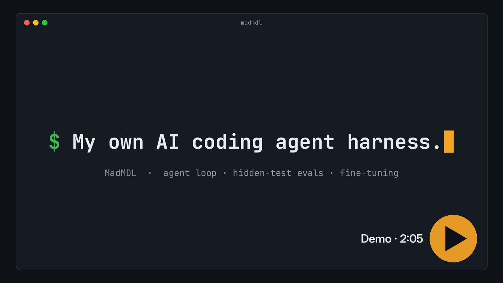
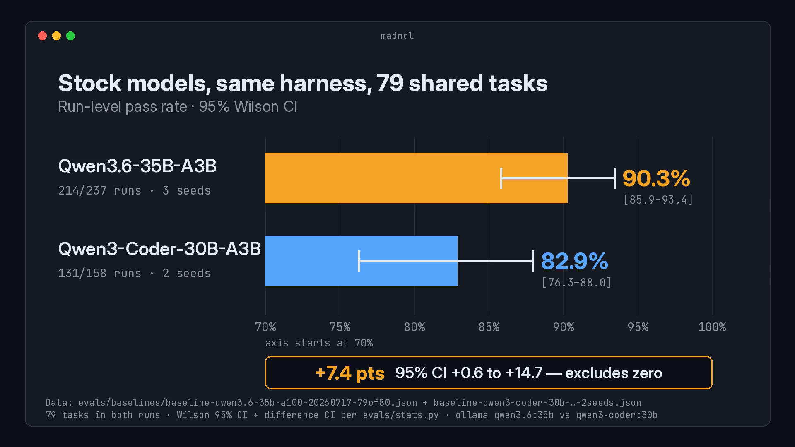
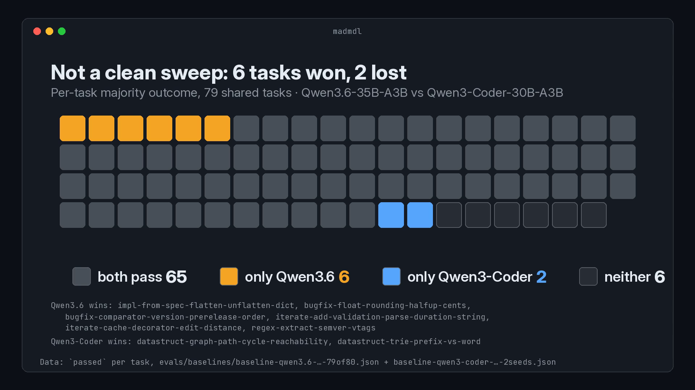
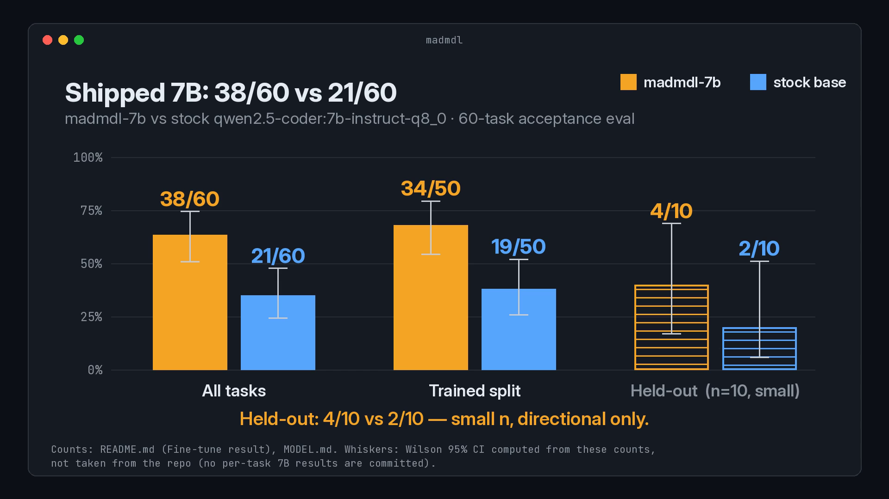

# MadMDL — demo

MadMDL is Veeti's private local AI coding agent harness, eval suite, and fine-tuning pipeline. The source is private; a demo is available on request.

[Watch the demo (2:05)](assets/madmdl_demo.mp4)

The terminal segment is a clearly labelled replay of a logged teacher run (claude:sonnet) from the training corpus, not a live run.

## Results

On 79 shared hidden-test tasks, Qwen3.6-35B-A3B solved 214/237 runs (90.3%) and Qwen3-Coder-30B-A3B solved 131/158 (82.9%). The difference is +7.4 points (95% CI +0.6 to +14.7).

*Qwen3.6-35B-A3B 214/237 (90.3%) vs Qwen3-Coder-30B-A3B 131/158 (82.9%) on 79 shared hidden-test tasks. Difference +7.4 pts (95% CI +0.6 to +14.7).*

*Per-task outcomes for Qwen3.6-35B-A3B and Qwen3-Coder-30B-A3B on the same 79 shared hidden-test tasks.*

The fine-tuned madmdl-7b scored 38/60 against 21/60 for its base. On the held-out split the scores are 4/10 vs 2/10 (small sample, directional).

*Fine-tuned madmdl-7b 38/60 vs 21/60 for its base. Held-out 4/10 vs 2/10 (small sample, directional).*

## Fine-tuning

Dense models are fine-tuned with QLoRA. Fused MoE expert weights use bf16 LoRA. Training ran on a rented A100 80GB.

## Music

"Deliberate Thought" by Kevin MacLeod (incompetech.com), [CC BY 3.0](https://creativecommons.org/licenses/by/3.0/). Trimmed and faded.

## Contact

[github.com/veetihietasalo](https://github.com/veetihietasalo)
